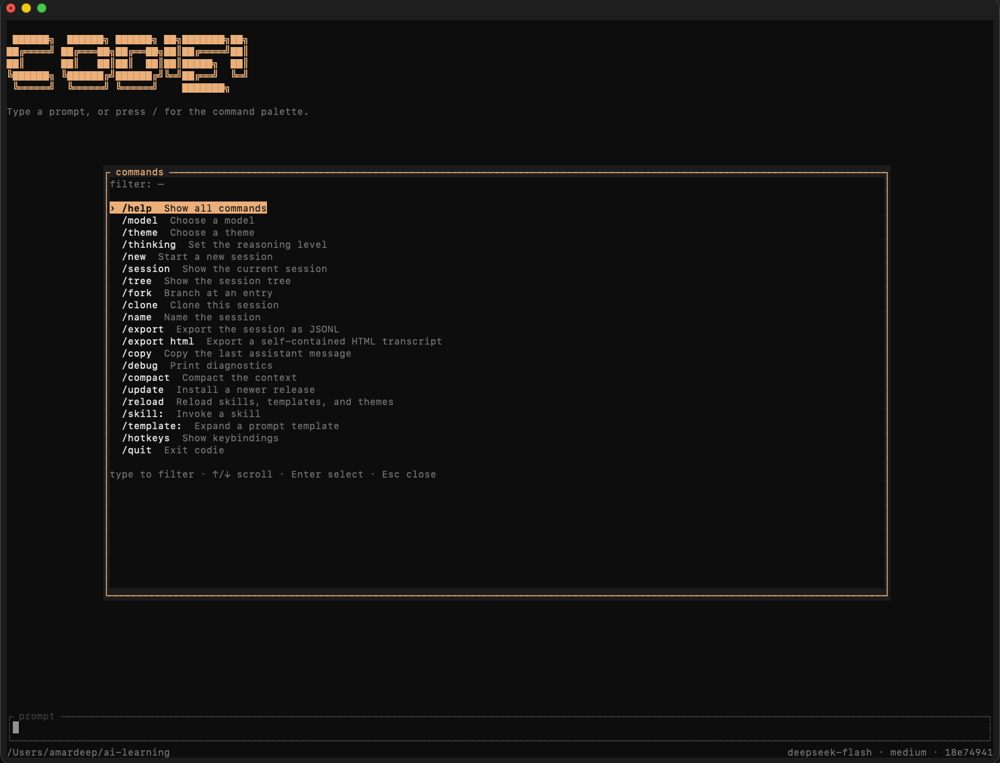
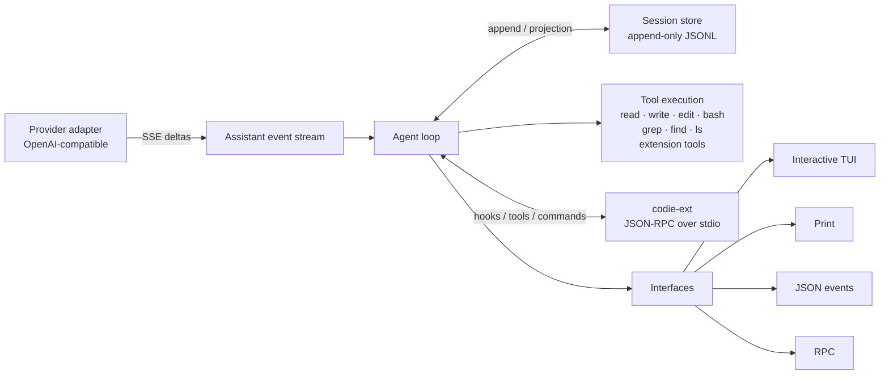
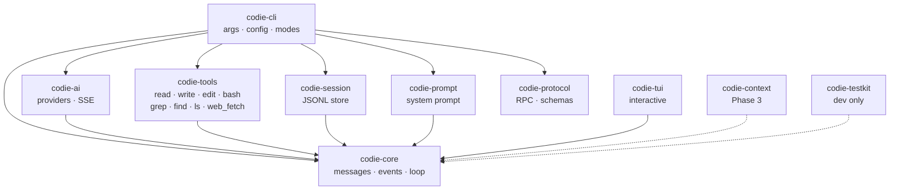

<p align="center">
  
</p>

<h1 align="center">Codie</h1>

<p align="center">
  <a href="https://www.rust-lang.org/"></a>
  
  
  
</p>

<p align="center">A fast, extensible, spec-driven coding agent for the terminal, written in Rust.</p>

Codie is a deliberate reimplementation of the architecture proven by [`pi`](https://github.com/earendil-works/pi).
It keeps the small event-driven core, append-only session tree, and provider abstraction, while changing the
implementation language, the safety posture, and the provider scope.

The command is `codie`.

**Status: Phase 5 complete (`0.6.1`), pre-alpha.** The one-shot agent, the interactive app,
full-fidelity sessions, customization, and automation all work end to end: streaming transcript, editor dock,
OpenCode-inspired themes, the startup banner, slash commands, steering, permission prompts, plain mode,
resume/fork/compact, search tools, skills, prompt templates, project trust, system instructions, `@file` and
image inputs, guarded `web_fetch`, RPC mode, generated JSON schemas, HTML transcript export, and
`codie update --check`. See
[`docs/src/configuration.md`](docs/src/configuration.md), [`docs/src/rpc.md`](docs/src/rpc.md), and
[`ROADMAP.md`](ROADMAP.md).

<p align="center">
  
</p>

## Why codie

- **One static binary.** No Node or Bun runtime, predictable memory, fast startup.
- **Safe by default.** Read-only tools are allowed; writes and shell commands ask interactively and are denied
  in headless mode unless explicitly allowed.
- **Provider discipline.** OpenRouter and DeepSeek at launch, behind one OpenAI-compatible adapter with
  recorded-fixture conformance. No live API calls in CI.
- **Sessions you can trust.** Append-only JSONL with resume, branch, fork, clone, and compaction. The file is
  the source of truth; the model-visible context is a projection.
- **Extensible without a plugin runtime.** Skills, templates, themes, and out-of-process extensions add tools,
  commands, and hooks; foreign code never runs in the agent's address space.
- **Spec-first engineering.** Every normative requirement has an ID, a test path, and a traceability check.

## Principles

1. Behavior is specified before it is implemented. No feature without a spec and a traceable test.
2. The transcript is the prompt. System prompt and tool declarations are persisted and replayed, with no
   hidden state.
3. Tool calls execute only after the assistant message is final. Tool failures are results, not loop failures.
4. The core stays small. Skills, templates, themes, and extensions layer on top; foreign code never runs in the
   agent's address space.
5. Provider and platform claims are backed by tests, not aspirations.

## Architecture



Crate graph (solid = shipping, dashed = planned):



The loop has no HTTP client. The provider adapter knows nothing about tool implementations. Only the CLI reads
environment variables and decides process exit codes. Details are in [`docs/src/architecture.md`](docs/src/architecture.md).

## Install

macOS 13+ on arm64 or x64 is tier 1; Linux glibc 2.31+ is best effort.

```bash
curl -fsSL https://raw.githubusercontent.com/amardeepio/codie/main/install.sh | sh
```

The installer places `codie` in `~/.local/bin`, verifies checksums when a prebuilt release exists, and prints
the `PATH` line to add if that directory is not already on your path. Tagged releases publish prebuilt archives
for macOS and Linux; when a tag has no artifact, it builds from source and installs Rust 1.88 through rustup
when necessary. Pass `--no-rust-install` to disable that.

Pin a version or pick another directory:

```bash
curl -fsSL https://raw.githubusercontent.com/amardeepio/codie/main/install.sh \
  | sh -s -- --version 0.6.1

curl -fsSL https://raw.githubusercontent.com/amardeepio/codie/main/install.sh \
  | sh -s -- --bin-dir "$HOME/bin"
```

Prefer to read the script before running it:

```bash
curl -fsSL https://raw.githubusercontent.com/amardeepio/codie/main/install.sh -o install.sh
less install.sh
sh install.sh
```

Uninstall with `rm ~/.local/bin/codie`. Full options and troubleshooting are in
[`docs/src/install.md`](docs/src/install.md).

## Quickstart

Requirements: Rust 1.88, installed through `rust-toolchain.toml`. macOS 13+ is the tier-1 platform. The
[install](#install) section above is the fastest path; build from source as follows for development.

```bash
git clone https://github.com/amardeepio/codie
cd codie
cargo build
cargo run -- --help
cargo run -- --version
```

Then authenticate once and run:

```bash
codie auth login openrouter
codie auth status
codie models

# or through cargo while developing:
cargo run -- auth login openrouter
```

Run one prompt:

```bash
cargo run -- -p --provider openrouter --model deepseek/deepseek-v4.1-flash-1017 \
  "Reply with exactly: codie-ok"

# Tool-using run in another directory (headless defaults deny mutating tools)
cargo run -- -p --allow-all --cwd /path/to/project \
  "Make the failing test pass, then run it"

# Automation
cargo run -- --mode json -p "Summarize this repository"
cargo run -- --mode rpc          # line-delimited JSON commands on stdin
cargo run -- update --check      # report newer releases without installing

# Extensions
cargo run -- --extension examples/extensions/todo -p "/todo"
cargo run -- --extension examples/extensions/todo --allow todo_add -p "add a todo: write docs"
```

Environment variables and `.env`:

```bash
cp .env.example .env      # optional; .env is gitignored
# or
cargo run -- --env-file .env.local models
```

Process environment always wins over `.env`. Supported variables: `DEEPSEEK_API_KEY`,
`OPENROUTER_API_KEY`, `CODIE_PROVIDER`, `CODIE_MODEL`, `CODIE_THINKING`, `CODIE_MAX_TURNS`,
`CODIE_ALLOW`, `CODIE_BASE_URL`, `CODIE_CONFIG_DIR`, `CODIE_DATA_DIR`, `CODIE_CACHE_DIR`,
`CODIE_SESSION_DIR`, `CODIE_ENV_FILE`, `CODIE_NO_UPDATE_CHECK`.

Run `codie` with no arguments in a terminal for the interactive app. Use `-p/--print` for one-shot output and
`--mode json` for automation. See [`docs/src/tui.md`](docs/src/tui.md) for keys, commands, themes, and
permissions. The full planned command surface is documented in [`PLAN.MD`](PLAN.MD) §4.2.

## Providers

| Provider | Status | API | Auth |
|---|---|---|---|
| DeepSeek | Phase 1 | OpenAI-compatible | `DEEPSEEK_API_KEY` |
| OpenRouter | Phase 1 | OpenAI-compatible | `OPENROUTER_API_KEY` |

Both are accessed through one adapter that handles SSE framing, tool-call accumulation, stop-reason and usage
mapping, retries, and per-provider compatibility flags. Anthropic-native passthrough, OAuth login, and
additional vendors are out of scope for v1.0. See [`docs/src/providers.md`](docs/src/providers.md) and
[`specs/provider/0001-openai-compatible.md`](specs/provider/0001-openai-compatible.md).

## Platforms

- **Tier 1:** macOS 13+ on arm64 and x64. Signed, notarized binaries; full CI suite; release-blocking.
- **Tier 2:** Linux glibc 2.31+ and WSL. Builds and core paths work; best-effort fixes.
- **Post-1.0:** Windows 10 21H2+ and other Unixes. No guarantees at 1.0.

Support claims and the macOS terminal matrix are in [`docs/src/platforms.md`](docs/src/platforms.md).

## Documentation

- [`PLAN.MD`](PLAN.MD) — scope, architecture, phases, decision log.
- [`specs/`](specs/) — normative requirements and the specification process.
- [`docs/src/`](docs/src/) — mdBook: introduction, architecture, development, configuration, interactive
  terminal, RPC, extensions, specs, providers, platforms, security, roadmap.
- [`examples/extensions/`](examples/extensions/) — Python and TypeScript extensions plus minimal SDKs.
- [`docs/adr/`](docs/adr/) — architecture decision records.
- [`docs/rfc/`](docs/rfc/) — change proposals for accepted or released behavior.
- [`CONTRIBUTING.md`](CONTRIBUTING.md) — development setup, spec-first workflow, PR checklist.
- [`GOVERNANCE.md`](GOVERNANCE.md) — decision making and release captains.
- [`CHANGELOG.md`](CHANGELOG.md) — release history.

Build the book with `mdbook build docs` and serve it with `mdbook serve docs`.

## Contributing

Contributions are welcome, but the process is strict: every feature needs an accepted spec and a named test.
Start with [`CONTRIBUTING.md`](CONTRIBUTING.md), then open an issue before a large change. Good first issues are
labeled in the tracker. Security reports follow the process in `SECURITY.md`.

## License

Licensed under either of:

- Apache License, Version 2.0 ([`LICENSE-APACHE`](LICENSE-APACHE))
- MIT License ([`LICENSE-MIT`](LICENSE-MIT))

at your option. Unless you explicitly state otherwise, any contribution intentionally submitted for inclusion in
this project shall be dual-licensed as above, without any additional terms or conditions.
