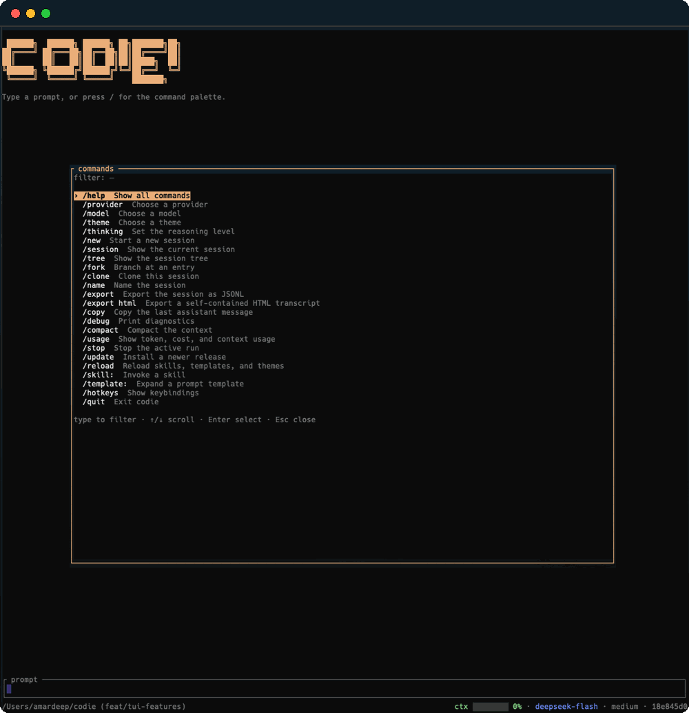

<p align="center">
  
</p>

<h1 align="center">Codie</h1>

<p align="center">
  <a href="https://www.rust-lang.org/"></a>
  
  
  
</p>

<p align="center">A fast, extensible, spec-driven coding agent for the terminal, written in Rust.</p>

Codie is a deliberate reimplementation of the architecture proven by [`pi`](https://github.com/earendil-works/pi):
a small event-driven core, an append-only session tree, and one OpenAI-compatible provider adapter. The command is
`codie`.

**Stable release `0.9.4`.** The one-shot agent, interactive TUI, sessions, customization, automation, extensions,
subagent delegation, and RPC v2 work end to end. See [`ROADMAP.md`](ROADMAP.md) and
[`docs/src/`](docs/src/).

<p align="center">
  
</p>

## Install

> [!TIP]
> **Install Codie with one command.** No Node or Bun runtime required.
>
> **macOS / Linux**
>
> ```bash
> curl -fsSL https://raw.githubusercontent.com/amardeepio/codie/main/install.sh | sh
> ```
>
> **Windows (PowerShell)**
>
> ```powershell
> irm https://raw.githubusercontent.com/amardeepio/codie/main/install.ps1 | iex
> ```

The Unix installer places `codie` in `~/.local/bin`, verifies release checksums, and prints the `PATH` line to add
if needed. The PowerShell installer places `codie.exe` in `%LOCALAPPDATA%\Programs\codie` and updates your user
`PATH`. Tagged releases include prebuilt archives; when one is missing, the Unix installer builds from source and
installs Rust 1.88 through rustup (pass `--no-rust-install` to disable that).

Pin a version or choose another directory:

```bash
curl -fsSL https://raw.githubusercontent.com/amardeepio/codie/main/install.sh \
  | sh -s -- --version 0.9.4

curl -fsSL https://raw.githubusercontent.com/amardeepio/codie/main/install.sh \
  | sh -s -- --bin-dir "$HOME/bin"
```

Full options and troubleshooting: [`docs/src/install.md`](docs/src/install.md) and
[`docs/src/windows.md`](docs/src/windows.md). Uninstall with `rm ~/.local/bin/codie`.

## Quickstart

Requirements: Rust 1.88, pinned in [`rust-toolchain.toml`](rust-toolchain.toml). macOS 13+ on arm64 is tier 1.

```bash
git clone https://github.com/amardeepio/codie
cd codie
cargo build
cargo run -- --help
```

Authenticate once, then run:

```bash
codie auth login openrouter   # verifies before storing
codie auth status
codie models
```

```bash
# One prompt
codie -p --provider openai --model gpt-6.2-sol "Reply with exactly: codie-ok"

# Local, no key required
codie --provider ollama --model qwen3-coder -p "Explain this repository"

# Automation and extensions
codie --mode json -p "Summarize this repository"
codie --mode rpc                 # line-delimited JSON on stdin
codie --extension examples/extensions/todo -p "/todo"
```

Run `codie` with no arguments for the interactive app: `/connect` adds a key, `/provider` switches, and `/auth`
shows credential status. Use `-p/--print` for one-shot output and `--mode json` for automation.

Environment and configuration use `CODIE_PROVIDER`, `CODIE_MODEL`, `CODIE_THINKING`, `CODIE_MAX_TURNS`,
`CODIE_ALLOW`, `CODIE_BASE_URL`, `CODIE_CONFIG_DIR`, `CODIE_DATA_DIR`, `CODIE_CACHE_DIR`, `CODIE_SESSION_DIR`,
`CODIE_ENV_FILE`, and `CODIE_NO_UPDATE_CHECK`. Copy [`.env.example`](.env.example) to `.env` for local overrides;
process environment wins.

## Why codie

- **One static binary.** No Node or Bun runtime, predictable memory, fast startup.
- **Safe by default.** Read-only tools run; writes and shell commands ask interactively and are denied in
  headless mode unless explicitly allowed.
- **Provider discipline.** 25 hosted and local providers behind one adapter, backed by recorded-fixture tests and
  no live API calls in CI.
- **Sessions you can trust.** Append-only JSONL with resume, branch, fork, clone, and compaction. The file is the
  source of truth; the model-visible context is a projection.
- **Extensible without a plugin runtime.** Skills, templates, themes, and out-of-process extensions add tools,
  commands, and hooks; foreign code never runs in the agent's address space.
- **Spec-first engineering.** Every normative requirement has an ID, a test path, and a traceability check.

## How it works

The agent loop has no HTTP client and never links a provider implementation. The provider adapter knows nothing
about tools. Tools execute only after the assistant message is final, and each tool implements a small contract
(`name`, schema, execution mode, `execute`). The CLI is the only layer that reads environment variables, opens
configuration, selects a provider, and decides the process exit code.

Delegated work is in-process. The `task` tool starts a child run with its own persona, model, tool subset, turn
budget, timeout, and child session. Children inherit the parent's permission policy, cannot escalate, and report
progress and usage through ordinary tool updates.

The TUI is an event-driven consumer of `AgentEvent`, not part of the loop. It owns the alternate screen,
transcript, editor, overlays, permission prompts, theme, and footer. Streaming is coalesced and cached per entry so
long sessions stay responsive. The same events power plain/print, JSON, and RPC interfaces; RPC v2 adds
interactive permissions, configuration access, and attachments for GUI clients.

Sessions are append-only JSONL with a tree of entries. Resume, fork, clone, and compaction operate on the file;
the model-visible history is a deterministic projection. Project memory (`CODIE.MD`) is a section-scoped notebook
loaded into context and edited only through the `project_memory` tool.

Details: [`docs/src/architecture.md`](docs/src/architecture.md), [`docs/src/tui.md`](docs/src/tui.md), and
[`specs/README.md`](specs/README.md).

## Providers

25 providers share one OpenAI-compatible adapter:

- **Hosted:** OpenAI, DeepSeek, OpenRouter, Google Gemini, Groq, Cerebras, Mistral, xAI, Together AI, DeepInfra,
  Fireworks AI, Moonshot AI, Z.AI, NVIDIA NIM, Nebius, SambaNova, Novita AI, Alibaba DashScope, Baseten, Requesty,
  OpenCode, and OpenCode Go.
- **Local, keyless:** Ollama, LM Studio, and vLLM.

`/connect` validates a key before storing it; `/provider` switches at runtime. OpenRouter and generic `/models`
catalogs refresh in the background. See [`docs/src/providers.md`](docs/src/providers.md).

## Benchmarks

[`benchmark/`](benchmark/) compares codie with opencode on the same machine, model, prompts, and Next.js
scaffold. On the latest full run (macOS arm64, 3 runs per harness per task), codie was **2.09x faster** on the
pooled median, **2.58x cheaper**, and used **2.01x fewer** tokens; task success was 11/12 versus opencode's 12/12.

```bash
./benchmark/run.sh all --runs 3 --yes
python3 benchmark/report.py --publish
```

See [`benchmark/REPORT.md`](benchmark/REPORT.md) for per-task timings and confidence intervals.

## Platforms

| Tier | Platforms |
|---|---|
| Tier 1 | macOS 13+ on arm64 and x64 (x64 installs from source). Release-blocking. |
| Tier 2 | Linux glibc 2.31+ and WSL. Best effort. |
| Preview | Windows 10 21H2+ / 11 x64. MSVC build, PowerShell installer, `powershell` tool. |
| Post-1.0 | Windows ARM64 and other Unixes. |

See [`docs/src/platforms.md`](docs/src/platforms.md) and [`docs/src/terminals.md`](docs/src/terminals.md).

## Documentation

- [`docs/src/`](docs/src/) — quickstart, installation, Windows, architecture, configuration, TUI, sessions, RPC,
  extensions, providers, platforms, security, releases, troubleshooting.
- [`PLAN.MD`](PLAN.MD) — scope, architecture, phases, decision log.
- [`specs/`](specs/) — normative requirements and the specification process.
- [`examples/extensions/`](examples/extensions/) — Python and TypeScript extensions plus minimal SDKs.
- [`CHANGELOG.md`](CHANGELOG.md) — release history.

Build the book with `mdbook build docs` and serve it with `mdbook serve docs`.

## Contributing

Contributions are welcome, but the process is strict: every feature needs an accepted spec and a named test. Start
with [`CONTRIBUTING.md`](CONTRIBUTING.md), then open an issue before a large change. Security reports follow
[`SECURITY.md`](SECURITY.md); decisions follow [`GOVERNANCE.md`](GOVERNANCE.md).

## License

MIT. See [`LICENSE-MIT`](LICENSE-MIT).
