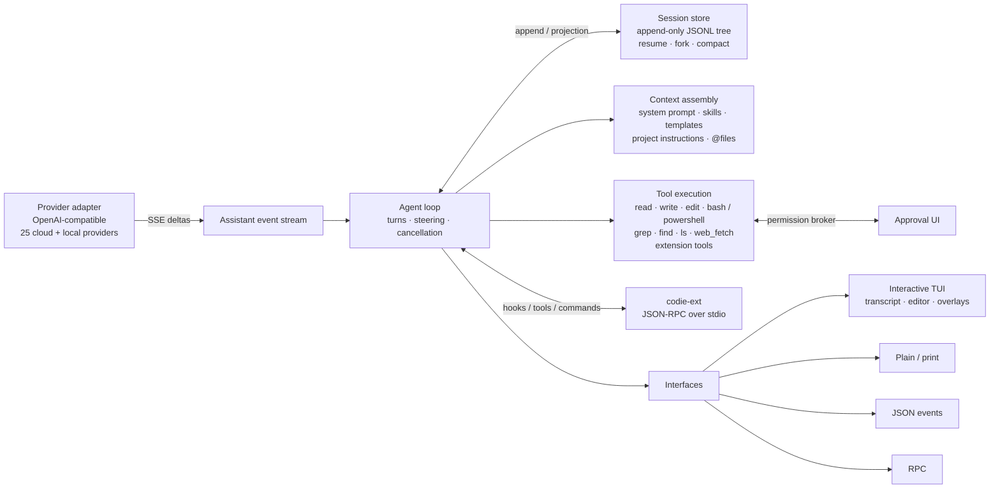
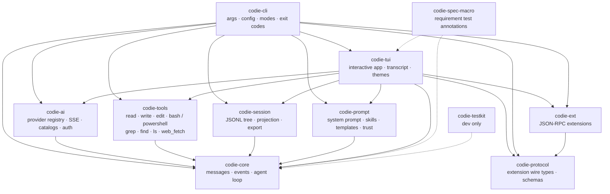

<p align="center">
  
</p>

<h1 align="center">Codie</h1>

<p align="center">
  <a href="https://www.rust-lang.org/"></a>
  
  
  
  
</p>

<p align="center">A fast, extensible, spec-driven coding agent for the terminal, written in Rust.</p>

Codie is a deliberate reimplementation of the architecture proven by [`pi`](https://github.com/earendil-works/pi).
It keeps the small event-driven core, append-only session tree, and provider abstraction, while changing the
implementation language, the safety posture, and the provider scope.

The command is `codie`.

**Status: stable release (`0.9.3`).** The one-shot agent, interactive TUI, sessions, customization, automation, and
out-of-process extensions work end to end. This release adds a 25-provider registry, TUI `/connect` with API-key
validation, live OpenAI-compatible model catalogs, keyless local providers (Ollama, LM Studio, vLLM), and persisted
provider/model selection. See [`docs/src/configuration.md`](docs/src/configuration.md),
[`docs/src/rpc.md`](docs/src/rpc.md), and [`ROADMAP.md`](ROADMAP.md).

<p align="center">
  
</p>

## Why codie

- **One static binary.** No Node or Bun runtime, predictable memory, fast startup.
- **Safe by default.** Read-only tools are allowed; writes and shell commands ask interactively and are denied
  in headless mode unless explicitly allowed.
- **Provider discipline.** 25 cloud and local providers behind one OpenAI-compatible adapter, driven by a static
  registry with recorded-fixture conformance and no live API calls in CI.
- **Sessions you can trust.** Append-only JSONL with resume, branch, fork, clone, and compaction. The file is
  the source of truth; the model-visible context is a projection.
- **Extensible without a plugin runtime.** Skills, templates, themes, and out-of-process extensions add tools,
  commands, and hooks; foreign code never runs in the agent's address space.
- **Spec-first engineering.** Every normative requirement has an ID, a test path, and a traceability check.

## Principles

1. Behavior is specified before it is implemented. No feature without a spec and a traceable test.
2. The transcript is the prompt. System prompt and tool declarations are persisted and replayed, with no
   hidden state.
3. Tool calls execute only after the assistant message is final. Tool failures are results, not loop failures.
4. The core stays small. Skills, templates, themes, and extensions layer on top; foreign code never runs in the
   agent's address space.
5. Provider and platform claims are backed by tests, not aspirations.

## Architecture



Crate graph (all shipping; testkit is dev-only and spec-macro runs at build time):



The agent loop has no HTTP client and never links a provider implementation. The provider adapter knows
nothing about tools. Tools execute only after the assistant message is final, and each tool implements a small
contract (`name`, schema, execution mode, `execute`). The CLI is the only layer that reads environment
variables, opens configuration, selects a provider, and decides the process exit code.

The TUI is an event-driven consumer of `AgentEvent`, not part of the loop. It owns the alternate screen,
transcript, editor, overlays, permission prompts, theme, and footer. Rendering is coalesced on a tick and cached
by transcript revision, width, and theme, so scrolling a session with large diffs stays responsive. The same
diff and numbered-code renderer powers edit results, write previews, and rich permission review. Escape and
`/stop` cancel model requests and tool process groups; session compaction uses the same cancellation token.

Sessions are append-only JSONL with a tree of entries. Resume, fork, clone, and compaction all operate on the
file; the model-visible history is a deterministic projection. Context assembly and compaction share the same
token estimator and reserve budget, which the footer exposes as a live context meter.

Details are in [`docs/src/architecture.md`](docs/src/architecture.md), [`docs/src/tui.md`](docs/src/tui.md),
and [`specs/README.md`](specs/README.md).

## Install

macOS 13+ on arm64 and x64 is tier 1 (x64 installs from source); Linux glibc 2.31+ is best effort; Windows 10 21H2+ / 11 x64 is a preview.

```bash
curl -fsSL https://raw.githubusercontent.com/amardeepio/codie/main/install.sh | sh
```

On Windows, open PowerShell:

```powershell
irm https://raw.githubusercontent.com/amardeepio/codie/main/install.ps1 | iex
```

The Unix installer places `codie` in `~/.local/bin`, verifies checksums when a prebuilt release exists, and
prints the `PATH` line to add if that directory is not already on your path. The PowerShell installer places
`codie.exe` in `%LOCALAPPDATA%\Programs\codie` and updates your user `PATH`. Tagged releases publish prebuilt
archives for macOS, Linux, and Windows; when a tag has no artifact, the Unix installer builds from source and
installs Rust 1.88 through rustup when necessary. Pass `--no-rust-install` to disable that.

Pin a version or pick another directory:

```bash
curl -fsSL https://raw.githubusercontent.com/amardeepio/codie/main/install.sh \
  | sh -s -- --version 0.9.3

curl -fsSL https://raw.githubusercontent.com/amardeepio/codie/main/install.sh \
  | sh -s -- --bin-dir "$HOME/bin"
```

```powershell
$env:CODIE_VERSION = "0.9.3"
irm https://raw.githubusercontent.com/amardeepio/codie/main/install.ps1 | iex
```

Prefer to read the script before running it:

```bash
curl -fsSL https://raw.githubusercontent.com/amardeepio/codie/main/install.sh -o install.sh
less install.sh
sh install.sh
```

Uninstall with `rm ~/.local/bin/codie`. Full options and troubleshooting are in
[`docs/src/install.md`](docs/src/install.md) and [`docs/src/windows.md`](docs/src/windows.md).

## Quickstart

Requirements: Rust 1.88, installed through `rust-toolchain.toml`. macOS 13+ is the tier-1 platform. The
[install](#install) section above is the fastest path; build from source as follows for development.
```bash
git clone https://github.com/amardeepio/codie
cd codie
cargo build
cargo run -- --help
cargo run -- --version
```

Then authenticate once and run:

```bash
codie auth login openrouter   # verifies before storing
codie auth status
codie models
```

Run one prompt:

```bash
cargo run -- -p --provider openai --model gpt-6.2-sol \
  "Reply with exactly: codie-ok"

# Local, no key required
cargo run -- --provider ollama --model qwen3-coder -p "Explain this repository"

# Tool-using run in another directory (headless defaults deny mutating tools)
cargo run -- -p --allow-all --cwd /path/to/project \
  "Make the failing test pass, then run it"

# Automation and extensions
cargo run -- --mode json -p "Summarize this repository"
cargo run -- --mode rpc          # line-delimited JSON commands on stdin
cargo run -- update --check      # report newer releases without installing
cargo run -- --extension examples/extensions/todo -p "/todo"
```

Environment variables and `.env`:

```bash
cp .env.example .env      # optional; .env is gitignored
cargo run -- --env-file .env.local models
```

Process environment wins over `.env`. Configuration uses `CODIE_PROVIDER`, `CODIE_MODEL`, `CODIE_THINKING`,
`CODIE_MAX_TURNS`, `CODIE_ALLOW`, `CODIE_BASE_URL`, `CODIE_CONFIG_DIR`, `CODIE_DATA_DIR`, `CODIE_CACHE_DIR`,
`CODIE_SESSION_DIR`, `CODIE_ENV_FILE`, and `CODIE_NO_UPDATE_CHECK`. Each remote provider reads its documented
`*_API_KEY`; local providers need none.

Run `codie` with no arguments for the interactive app: `/connect` adds a key, `/provider` switches, `/auth` shows
credential status, and the last selection is reused next time. Use `-p/--print` for one-shot output and
`--mode json` for automation. See [`docs/src/tui.md`](docs/src/tui.md) for keys, commands, themes, and permissions.

## Providers

25 providers share one OpenAI-compatible adapter:

- **Hosted:** OpenAI, DeepSeek, OpenRouter, Google Gemini, Groq, Cerebras, Mistral, xAI, Together AI, DeepInfra,
  Fireworks AI, Moonshot AI, Z.AI, NVIDIA NIM, Nebius, SambaNova, Novita AI, Alibaba DashScope, Baseten, Requesty,
  OpenCode, and OpenCode Go.
- **Local, keyless:** Ollama, LM Studio, and vLLM.

`/connect` validates a key before storing it; `/provider` shows connection state and switches at runtime.
OpenRouter and generic `/models` catalogs refresh in the background, and only chat models reach the picker.
Anthropic-native, Azure, Vertex, Bedrock, and Copilot OAuth remain out of scope. See
[`docs/src/providers.md`](docs/src/providers.md).

## Benchmarks

[`benchmark/`](benchmark/) compares codie with opencode on the same machine, model
(`deepseek/deepseek-v4.1-flash-1017` through OpenRouter), prompts, and Next.js scaffold. The suite covers four
tasks: a greenfield todo UI, a brownfield feature addition, a hidden-test bug fix, and a JSON API. Browser,
hidden-test, and HTTP verifiers run only after each harness exits.

Latest full run (macOS arm64, 3 runs per harness per task): codie was **2.09x faster** on the pooled median,
**2.58x cheaper**, and used **2.01x fewer** tokens; task success was 11/12 versus opencode's 12/12. See
[`benchmark/REPORT.md`](benchmark/REPORT.md) for per-task timings, confidence intervals, and telemetry.

Run it with:

```bash
./benchmark/run.sh all --runs 3 --yes
python3 benchmark/report.py --publish
```

## Platforms

- **Tier 1:** macOS 13+ on arm64 and x64 (x64 installs from source). Release-blocking; Developer ID signing
  and notarization are required before the 1.0 gate.
- **Tier 2:** Linux glibc 2.31+ and WSL. Builds and core paths work; best-effort fixes.
- **Preview:** Windows 10 21H2+ / 11 x64. MSVC build, one-command PowerShell installer, `powershell` tool;
  no `bash`, no Job Objects, no ConPTY matrix, unsigned.
- **Post-1.0:** Windows ARM64 and other Unixes.

Support claims and the terminal matrix are in [`docs/src/platforms.md`](docs/src/platforms.md) and
[`docs/src/terminals.md`](docs/src/terminals.md).

## Documentation

- [`PLAN.MD`](PLAN.MD) — scope, architecture, phases, decision log.
- [`specs/`](specs/) — normative requirements and the specification process.
- [`docs/src/`](docs/src/) — mdBook: quickstart, installation, Windows preview, architecture, development,
  configuration, interactive terminal, terminal compatibility, sessions, RPC, extensions, specs, providers,
  platforms, Gatekeeper, troubleshooting, security, releases, roadmap.
- [`examples/extensions/`](examples/extensions/) — Python and TypeScript extensions plus minimal SDKs.
- [`docs/adr/`](docs/adr/) — architecture decision records.
- [`docs/rfc/`](docs/rfc/) — change proposals for accepted or released behavior.
- [`CONTRIBUTING.md`](CONTRIBUTING.md) — development setup, spec-first workflow, PR checklist.
- [`GOVERNANCE.md`](GOVERNANCE.md) — decision making and release captains.
- [`CHANGELOG.md`](CHANGELOG.md) — release history.

Build the book with `mdbook build docs` and serve it with `mdbook serve docs`.

## Contributing

Contributions are welcome, but the process is strict: every feature needs an accepted spec and a named test.
Start with [`CONTRIBUTING.md`](CONTRIBUTING.md), then open an issue before a large change. Good first issues are
labeled in the tracker. Security reports follow the process in `SECURITY.md`.

## License

Licensed under the MIT License ([`LICENSE-MIT`](LICENSE-MIT)).
