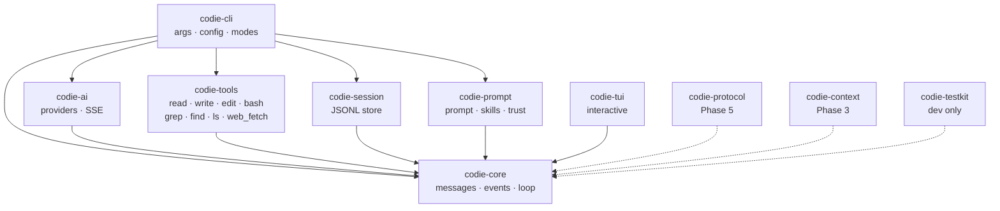

# Architecture

codie separates the wire, the conversation, the loop, and the interfaces. The separation is enforced by crate
boundaries, not convention: the loop has no HTTP client, the provider adapter knows nothing about tool
implementations, and only the CLI reads environment variables or decides process exit codes.

## Crate graph

Solid edges ship in 0.6.0; dashed edges are planned.



The graph is deliberately wider than the current workspace. `context` and `protocol` are split out when a
second consumer appears. Premature crates are as harmful as monolithic modules.

Current repository crates are `codie-core`, `codie-ai`, `codie-tools`, `codie-session`, `codie-prompt`,
`codie-tui`, `codie-cli`, `codie-testkit`, and the `codie-spec-macro` helper used by the test attribute.
`xtask` is repository automation, not a shipped library.

## Boundaries

- `codie-core` has no internal dependencies. It owns messages, content, events, tool traits, and the agent loop.
  It performs no I/O, terminal work, or HTTP.
- `codie-ai` owns HTTP, SSE, provider quirks, retries, model metadata, and credential resolution. It never knows
  how a tool is implemented.
- `codie-tools` depends on `codie-core` for the tool trait, never the reverse.
- `codie-session` owns the append-only store and projection. It does not call providers. Branch selections are
  persisted as leaf markers; fork and clone write new files and never touch the source.
- `codie-prompt` discovers project instructions and builds deterministic system prompts.
- `codie-cli` is the only crate that reads environment variables or maps outcomes to process exit codes.
- Public APIs are `pub(crate)` by default; crates expose narrow, documented surfaces.

## Runtime model

- One `tokio` multi-thread runtime.
- One agent task owns the loop and serializes state transitions.
- Events flow over a bounded `mpsc` channel (capacity 256) to the UI or protocol writer, so backpressure is real
  and memory is bounded.
- Phase 1 executes parallel tool calls with `FuturesUnordered`, preserving source order for results while
  emitting completion-order events. A concurrency cap arrives with the TUI workload.
- Cancellation uses `tokio_util::sync::CancellationToken` at every I/O boundary.
- Blocking work stays off the reactor; filesystem operations use `tokio::fs` and shell commands use
  `tokio::process`.
- Process-group termination on abort/timeout is Phase 7 hardening; Phase 1 kills the direct child.

## Built-in tools

`codie-tools` exposes seven wire-stable tools. `read`, `grep`, `find`, and `ls` are read-only; `write`, `edit`,
and `bash` mutate or execute and are gated by the permission policy.

| Tool | Purpose | Notes |
|---|---|---|
| `read` | Read a UTF-8 file | `offset`/`limit`; 2,000-line and 50 KiB caps |
| `write` | Create or overwrite a file | Creates parent directories; per-path lock |
| `edit` | Exact-text replacements | Rejects missing, duplicate, overlapping, and no-op edits |
| `bash` | Run a shell command | Optional timeout; output tail truncation |
| `grep` | Regex content search | `path`, `glob`, `case_sensitive`, `max_results`; skips binaries |
| `find` | Glob path search | Patterns without `/` match base names at any depth |
| `ls` | One directory listing | `path`, `all`; sizes, symlink targets |
| `web_fetch` | Fetch one HTTP(S) URL | Not read-only; blocks private addresses and caps bytes/time |

`grep` and `find` share an `ignore`-based walker, so `.gitignore`, git excludes, and hidden entries behave the
same way in both. Tool output is bounded by `max_results` and the shared truncation caps (`SPEC-TOOL-002`).

`codie-prompt` also owns customization: `SYSTEM.md`/`APPEND_SYSTEM.md`, skills, templates, project trust, and
`@path` expansion. Trust is checked before any project resource is read (`SPEC-TRUST-001`).

## State layering

```text
SessionStore (append-only JSONL, source of truth)
        │  projection (branch + compaction + context edits)
        ▼
Transcript (Vec<Message>)  ──►  ProviderContext (normalized for wire)
        │
        ▼
AgentState (derived: messages, streaming partial, pending tool calls)
```

The loop works on a working copy. `AgentState` is reduced from events. Persistence happens only on a finalized
`MessageEnd`, never on partials. This is what makes replay, fork, and compaction safe.

## Event flow

A provider stream is `start -> text/thinking/toolcall deltas -> done|error`, carrying a live partial message.
The agent loop wraps it in run and turn events, then executes the tool batch after the assistant message is
final. Tool results are appended in source order even when execution completes out of order. The full ordering
is normative in [`specs/agent/0001-turn-loop.md`](../../specs/agent/0001-turn-loop.md).

## Where behavior is specified

- Message model and assistant events: [`specs/message/0001-message-model.md`](../../specs/message/0001-message-model.md).
- Turn loop, steering, abort, hooks: [`specs/agent/0001-turn-loop.md`](../../specs/agent/0001-turn-loop.md).
- Provider wire behavior: [`specs/provider/0001-openai-compatible.md`](../../specs/provider/0001-openai-compatible.md).
- Scope, phases, and crate policy: [`PLAN.MD`](../../PLAN.MD) §5.
